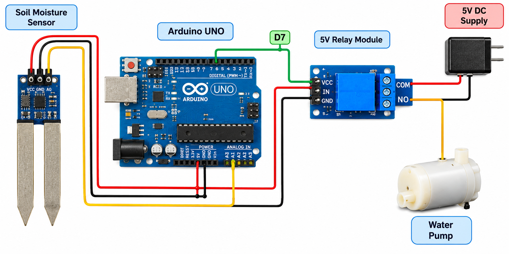
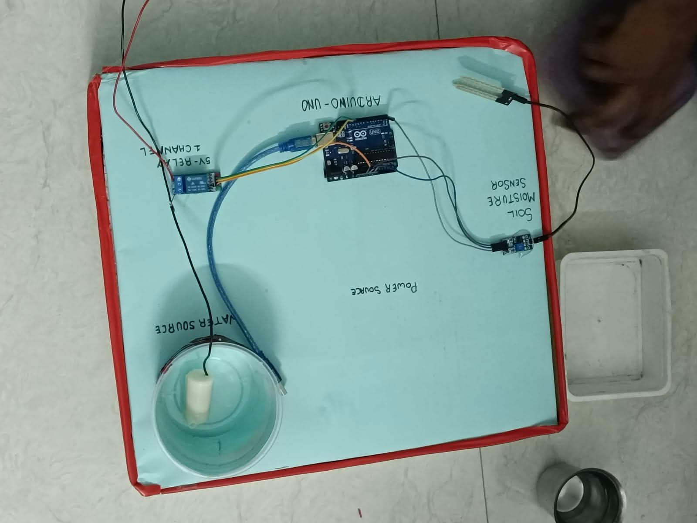

# Automatic Water Irrigation System

## Project Overview

The Automatic Water Irrigation System is an Arduino UNO-based project designed to automate the irrigation process by monitoring soil moisture levels. The system uses a soil moisture sensor to detect the moisture condition of the soil and sends the readings to the Arduino UNO for processing.

Based on the detected moisture level, the Arduino controls a relay module that operates a water pump. When the soil becomes dry, the water pump is activated to supply water to the plants. Once sufficient moisture is detected, the pump is switched OFF.

This project demonstrates the application of embedded systems, sensor-based monitoring, and automation in agricultural irrigation. It aims to reduce manual intervention and support efficient water management.

## Project Objectives

- To monitor soil moisture levels automatically.
- To control water supply based on soil conditions.
- To automate the operation of a water pump.
- To reduce unnecessary water usage.
- To demonstrate Arduino-based automation in agriculture.

## Hardware Components

- Arduino UNO
- Soil Moisture Sensor
- 5V Relay Module
- Water Pump
- Connecting Wires
- Power Supply

## Working Principle

1. The soil moisture sensor detects the moisture level in the soil.
2. The sensor sends the corresponding signal to the Arduino UNO.
3. Arduino processes the sensor readings.
4. When the soil is dry, the Arduino activates the relay module.
5. The relay switches ON the water pump, supplying water to the plants.
6. When sufficient moisture is detected, the relay switches OFF the pump.

## Circuit Diagram

## Project Prototype

## Technologies Used

- Arduino UNO
- Embedded C/C++ (Arduino Programming)
- Soil Moisture Sensing
- Relay-Based Pump Control

  ## Arduino Source Code

The Arduino source code for the Automatic Water Irrigation System is available in the following directory:

[View Arduino Source Code](Arduino_Code/Automatic_Water_Irrigation.ino)

The program demonstrates soil moisture monitoring and automatic water pump control using an Arduino UNO and relay module.

**Note:** This is a reconstructed representative implementation based on the available project information, not the verified original source code.

## Applications

- Home gardening
- Small-scale plant irrigation
- Agricultural automation demonstrations
- Smart irrigation prototypes

## Future Enhancements

- Integration of IoT-based remote monitoring.
- Mobile application-based monitoring and control.
- Real-time soil moisture data display.
- Automatic irrigation scheduling.

**Note:** The original source code was unavailable. The accompanying Arduino program is a reconstructed representative implementation based on the available project information, not the verified original program.
